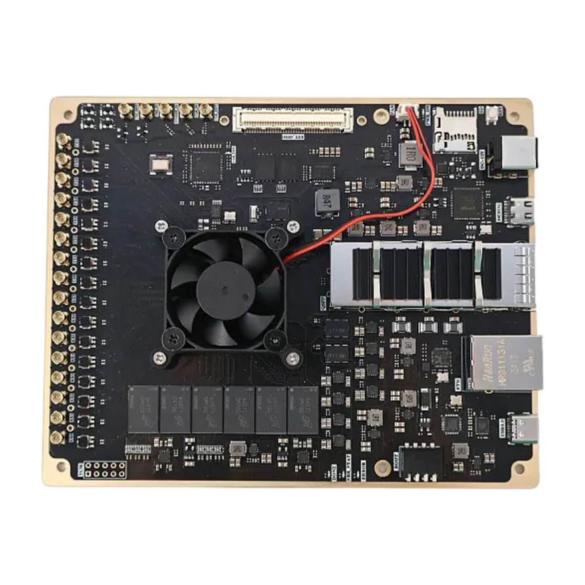
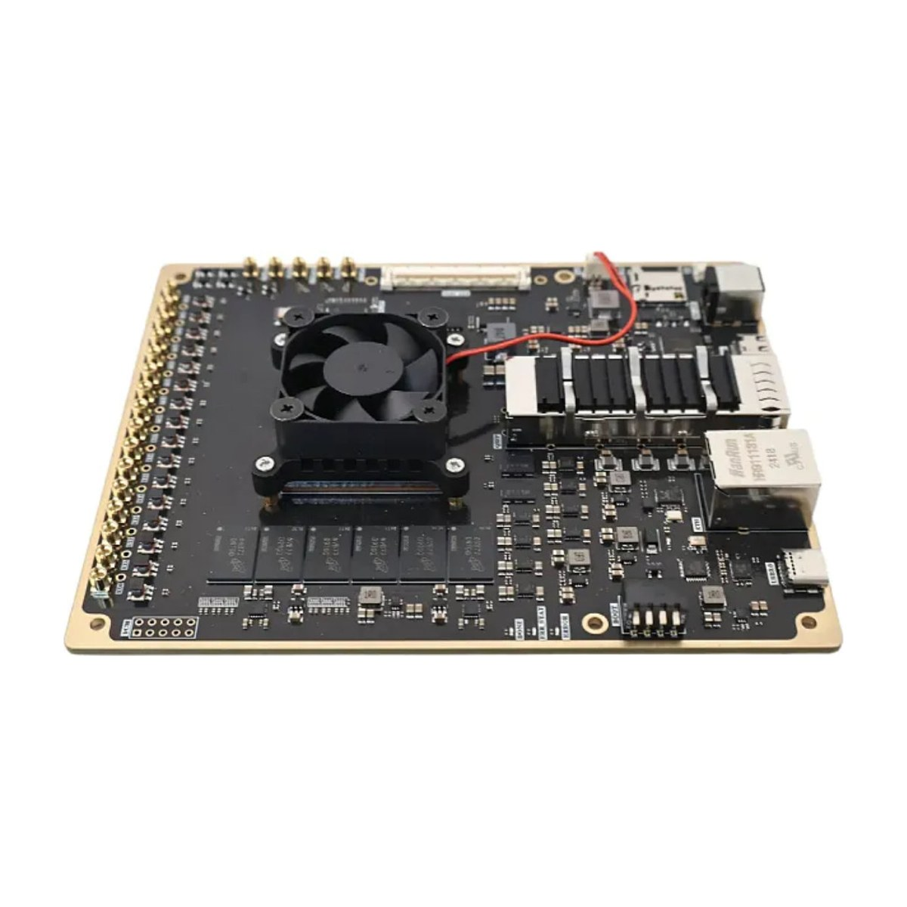

# RFSoC-27DR

Schematic, Vivado/Vitis 2023.2 reference designs and test programs for the **OpenSourceSDRLab RFSoC development board**, an 8T8R board built around the AMD Zynq UltraScale+ RFSoC **XCZU27DR** with a USB 3.0 port.

  
  

## Product link

<https://opensourcesdrlab.com/products/opensourcesdrlab-rfsoc-development-board-equipped-with-usb-30-socket>

## About the board

- Device: AMD Zynq UltraScale+ RFSoC **XCZU27DR** (speed grade -2, FSVE1156 or FFVE1156 package), quad-core Arm Cortex-A53 and dual-core Cortex-R5F plus programmable logic
- **8 RF-ADC** channels, 12-bit, up to 4.096 GSPS, and **8 RF-DAC** channels, 12-bit, up to 6.554 GSPS, on MMCX connectors (balun-coupled)
- Clocking: TI **LMK04828** jitter cleaner providing the RF-ADC/RF-DAC reference clocks, PL clock and SYSREF; MMCX inputs/outputs for an external clock, SYSREF and trigger signals
- Memory: PS DDR4 64-bit 2 GB, PL DDR4 32-bit 1 GB, 128 MB QSPI flash (two MT25QU512 in dual-parallel mode), microSD card slot, I2C EEPROM
- High-speed interfaces: **QSFP28** cage on a GTY quad (up to 4 × 25 Gb/s), USB 3.0 Type-C (PS), Gigabit Ethernet (PS, RTL8211F PHY)
- Expansion: Hirose FX10A-120S-SV connector with PL LVDS I/O, PS MIO, PS-GTR and GTY lanes
- Debug: JTAG and UART over one USB Type-C port (FT2232H), boot-mode switch (JTAG / QSPI / eMMC / SD), 4 user LEDs, fan header
- Power: 12 V DC; board size 12 × 15 cm
- Reference designs: Vivado and Vitis **2023.2**, bare-metal (no OS)

## Quick start

1. Download `RFSoC-27DR_AD-DA-Loopback_prebuilt_Vivado2023.2.zip` from the [Releases](../../releases) page, build `BOOT.bin` with `bootgen -arch zynqmp -image boot.bif -o BOOT.bin -w` (bootgen comes with Vivado/Vitis) and copy it to a FAT32 microSD card.
2. Set the boot switch to SD, connect the USB Type-C debug port, open a serial terminal at 115200 baud and power the board from 12 V.
3. Connect an RF-DAC output to an RF-ADC input with an MMCX cable and watch the received tone in the Vivado Hardware Manager (ILA).

The full steps are in the **[Quick Start Guide](docs/Quick-Start-Guide.md)** ([PDF](docs/Quick-Start-Guide.pdf)).

## Repository layout

| Path | Contents |
|---|---|
| `hardware/` | Board schematic (PDF, main sheets) |
| `vivado/AD_DA_Loopback/AD_DA_LOOP_MTS_PL/` | Vivado 2023.2 project: RF Data Converter (8 ADC + 8 DAC at 4.096 GSPS), DDS test tone, ILA, AXI control registers |
| `vivado/AD_DA_Loopback/AD_DA_LOOP_MTS_PS/` | Vitis 2023.2 application sources: RF loopback (`AD_DA_LOOP_MTS`), PS DDR4 diagnostics (`DDR4_Test`), Ethernet echo server (`LWIP_Echo_Test`), USB mass-storage example (`xusb_poll_example_1`), and the hardware platform `rfsoc_top.xsa` |
| `vivado/AD_DA_Loopback/lmk04828.tcs` | LMK04828 register settings (TI TICS Pro file) used by the loopback design |
| `vivado/GTY_IBERT_25G/` | IBERT example design for the QSFP28 GTY quad at 25 Gb/s |
| `vivado/PL_DDR4_Test/` | PL DDR4 write/read test with ILA |
| `docs/` | Quick Start Guide (Markdown and PDF) |
| `images/` | Product photos |

## Downloads (Releases)

Large files are attached to the [Releases](../../releases) page instead of being stored in the repository:

| File | Contents |
|---|---|
| `RFSoC-27DR_AD-DA-Loopback_prebuilt_Vivado2023.2.zip` | Bitstream, `.ltx`, `.xsa`, FSBL, PMU firmware, the four application `.elf` files and a `boot.bif` for building an SD-card `BOOT.bin` |
| `RFSoC-27DR_GTY-IBERT-25G_prebuilt_Vivado2023.2.zip` | IBERT bitstream and `.ltx` for the QSFP28 link test |
| `RFSoC-27DR_PL-DDR4-Test_prebuilt_Vivado2023.2.zip` | PL DDR4 test bitstream and `.ltx` |
| `SHA256SUMS.txt` | SHA-256 checksums of the files above |

Check a download with `shasum -a 256 -c SHA256SUMS.txt` (macOS / Linux) or `certutil -hashfile <file> SHA256` (Windows).

## Licence

Files created by OpenSourceSDRLab are released under the [Apache License 2.0](LICENSE). Parts of the reference designs come from AMD/Xilinx and ALINX and remain under their own licences; see [NOTICE.md](NOTICE.md).

## Support

- Email: support@opensourcesdrlab.com
- Forum: <https://forum.opensourcesdrlab.com>
- Discord: <https://discord.gg/nnxY6DkmvT>
- Blog and user manuals: <https://blog.opensourcesdrlab.com>

---
© 2026 OpenSourceSDRLab. All rights reserved. · <a href="https://www.opensourcesdrlab.com">www.opensourcesdrlab.com</a>
